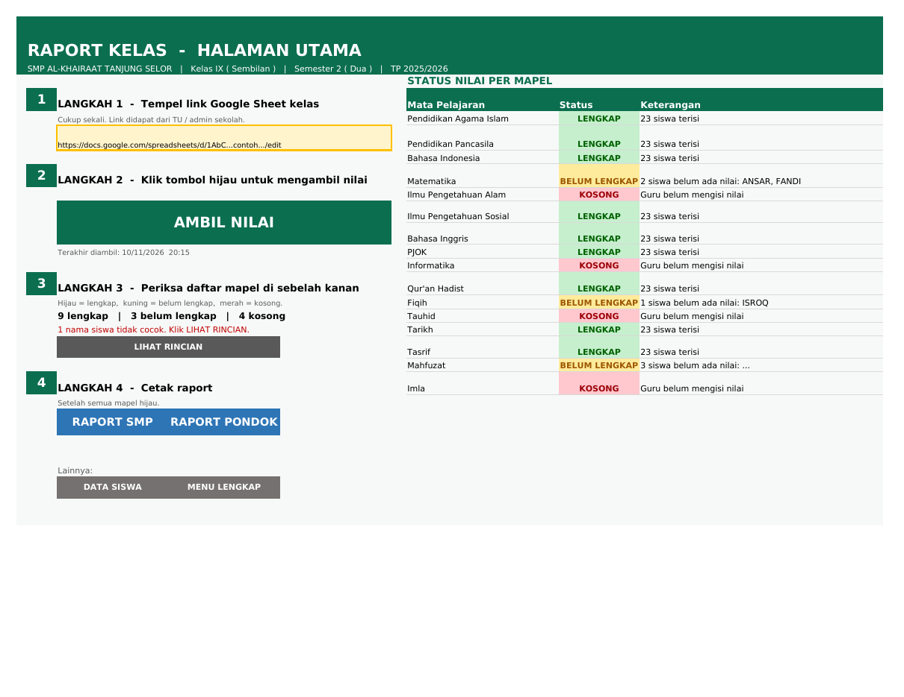
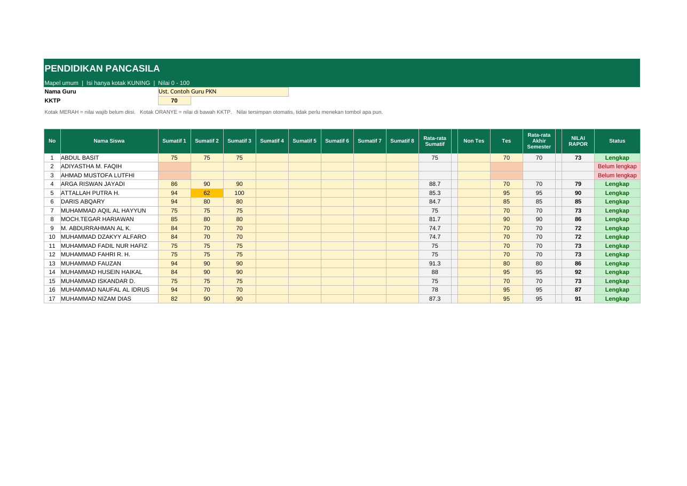

# Panduan Raport Otomatis

**Guru mengisi nilai di Google Sheet, lalu wali kelas cukup klik satu tombol, dan nilai masuk ke raport.**
Bentuk raport yang dicetak **tidak berubah**.

| Siapa | Yang dikerjakan | Seberapa sering |
|---|---|---|
| **TU / admin** | Menyiapkan Google Sheet setiap kelas (di Drive sekolah) dan raport induk dengan halaman BERANDA | Sekali per semester |
| **Wali kelas** | Mengisi nama siswa di Google Sheet, membagikan link ke guru, lalu klik **AMBIL NILAI** | Saat nilai sudah masuk |
| **Guru mapel** | Membuka link, lalu mengisi kotak kuning | Saat menilai |

Berkas yang dipakai:
- `contoh_google_sheet/CONTOH_NILAI_KELAS.xlsx`: contoh Google Sheet satu kelas (28 mapel)
- `excel/AmbilNilai.bas`: halaman BERANDA dan tombol AMBIL NILAI untuk raport Excel

---

## 1. TU: menyiapkan Google Sheet kelas (di Drive sekolah)

Pakai akun Google **sekolah**, bukan akun pribadi.

1. Buka Google Drive sekolah, lalu buat folder, misalnya **NILAI RAPORT 2026-2027 SEMESTER 1**.
2. Unggah file **CONTOH_NILAI_KELAS.xlsx** ke folder itu.
3. Klik kanan file itu, pilih **Buka dengan → Google Spreadsheet**, lalu pilih menu **File → Simpan sebagai Google Spreadsheet**.
4. Untuk **setiap kelas**: buka file tadi, pilih **File → Buat salinan**, lalu beri nama yang jelas.
   Contoh: `NILAI VII A - Smt 1 2026-2027`.
5. Di tab **PETUNJUK**, ganti tulisan "KELAS ...." dengan nama kelasnya.
6. **Bagikan** (tombol hijau kanan atas):
   - **Akses umum → Siapa saja yang memiliki link → Pelihat**. Ini wajib, supaya tombol di raport bisa mengambil nilai.
   - Tambahkan email **wali kelas** dan **guru mapel** sebagai **Editor**.
7. Kirim link setiap kelas ke wali kelasnya.

**Supaya tidak kacau (disarankan):** kunci setiap tab supaya hanya guru mapelnya yang bisa mengisi.
Klik kanan tab (misalnya **FIQIH**), pilih **Lindungi sheet → Setel izin → Hanya Anda**, lalu tambahkan email guru Fiqih.
Lakukan juga untuk tab **SISWA**, cukup untuk wali kelas.

> Nama tab jangan diubah. Tombol AMBIL NILAI mencari tab berdasarkan namanya (PKN, MTK, FIQIH, dan seterusnya).
> Mapel yang tidak diajarkan di kelas itu biarkan kosong saja.

## 2. TU: memasang halaman BERANDA di raport induk (sekali saja)

**Cara termudah:** kirim file raport induk (`.xlsm`) ke admin. Admin memasangkan BERANDA dengan alat `alat/pasang_beranda.py`,
lalu mengembalikan file baru bernama `... - BERANDA.xlsm`. Tidak perlu membuka jendela kode apa pun.

Saat file itu dibuka:
1. Klik **Enable Content / Aktifkan Konten** pada pita kuning.
   Kalau ada pita merah **"Microsoft telah memblokir makro"**: tutup file, klik kanan file, pilih **Properties**,
   centang **Unblock** di bagian bawah, klik **OK**, lalu buka lagi.
2. Halaman **BERANDA** dibuat dan dibuka otomatis.
3. Tekan **Ctrl + S**. Raport siap dibagikan ke wali kelas.

Setiap kali raport dibuka, halaman BERANDA langsung tampil.

**Cara manual** (kalau tidak memakai alat tadi): buka raport → **Alt + F11** → **File → Import File...** → pilih
`excel/AmbilNilai.bas` → tutup jendela → **Alt + F8** → pilih **BuatBeranda** → **Run** → **Ctrl + S**.

## 3. Wali kelas: 4 langkah di halaman BERANDA

1. **Tempel link** Google Sheet kelas di kotak kuning (cukup sekali).
2. Klik tombol hijau **AMBIL NILAI**. Tunggu beberapa detik.
3. Lihat daftar mapel di sebelah kanan:
   - 🟩 **LENGKAP**: semua siswa sudah punya nilai.
   - 🟨 **BELUM LENGKAP**: ada siswa yang belum dinilai. Namanya tertulis di kolom Keterangan.
   - 🟥 **KOSONG**: guru belum mengisi.

   Kalau ada **nama siswa tidak cocok**, klik **LIHAT RINCIAN**, samakan ejaannya, lalu klik AMBIL NILAI lagi.
4. Kalau semua sudah hijau, klik **RAPORT SMP** atau **RAPORT PONDOK** untuk mencetak, seperti biasa.

Tombol boleh diklik berkali-kali. Setiap kali guru menambah nilai, klik lagi.
**Jangan lupa simpan raport (Ctrl + S).**

Sekali saja di awal: di Google Sheet tab **SISWA**, isi nama siswa **persis sama** dengan sheet `siswa` di raport.
Cara paling mudah: salin dari raport, lalu tempel.

## 4. Guru mapel: mengisi nilai

1. Buka link dari wali kelas (bisa dari HP).
2. Klik tab mata pelajaran Anda di bagian bawah.
3. Isi **kotak kuning** saja, dengan angka 0 sampai 100.
   - Kotak **merah** = nilai wajib yang belum diisi.
   - Kotak **oranye** = nilai di bawah KKTP.
   - Kolom **Status** menjadi hijau "Lengkap" bila sudah cukup.
4. Selesai. Nilai tersimpan sendiri.

---

## Kalau ada masalah

| Yang muncul | Yang perlu dilakukan |
|---|---|
| "Nilai tidak bisa diambil" | Periksa internet. Periksa juga apakah Google Sheet sudah dibagikan **Siapa saja yang memiliki link → Pelihat**. |
| "Isi kotak kuning bukan link Google Sheet" | Salin ulang link lengkapnya: `https://docs.google.com/spreadsheets/d/.../edit` |
| Sebuah mapel tidak muncul di daftar | Nama tab di Google Sheet berbeda. Samakan dengan contoh (PAI, PKN, B. INDO, MTK, ...). |
| Tombol tidak bereaksi | Makro belum aktif. Tutup raport, buka lagi, lalu klik **Enable Content**. |
| Nama siswa tidak cocok | Samakan ejaan di tab SISWA (Google Sheet) dengan sheet `siswa` (raport). |

## Untuk admin: aturan yang dijaga

- Daftar siswa di raport **tidak diubah**. Siswa dicocokkan berdasarkan **nama**. Beda titik atau spasi tetap dianggap cocok.
- **Rumus raport tidak ditimpa**, kecuali 2 kolom Nilai Raport mapel pondok, yang memakai hitungan guru di Google Sheet.
- Sheet Ff11 dibuka kuncinya sebentar, lalu dikunci lagi.
- Daftar tab dan letak kolomnya ada di sheet tersembunyi **PENGATURAN**. Untuk membukanya: klik kanan nama sheet mana saja, lalu pilih **Unhide / Tampilkan**.
  Untuk raport SD atau MA yang letak kolomnya berbeda, cukup ubah tabel ini.
- Susunan tab Google Sheet: kolom A = nomor, B = nama, nilai mulai kolom C.
  - Mapel umum: C–J Sumatif 1–8, M Non Tes, N Tes.
  - Mapel pondok: C–F Tugas, G–I Lisan, J Semester, K–L Nilai Raport teori/praktik.
